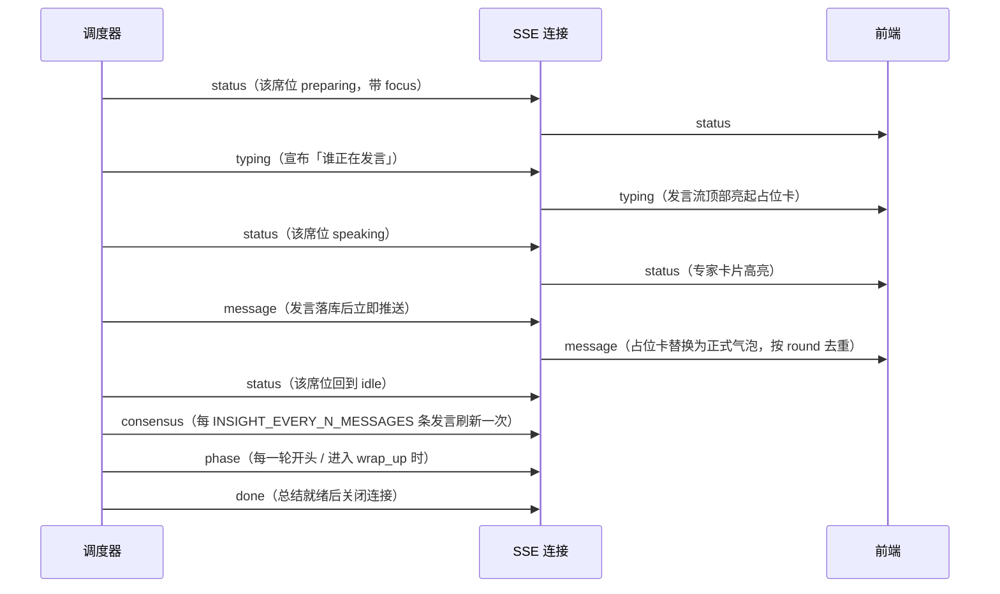

# 接口契约（API）

| 项目 | 内容 |
|---|---|
| 版本 | v1.0（SDD 阶段定稿，P2 起按此实现） |
| Base URL | `http://127.0.0.1:8000` |
| 契约真源 | `backend/schemas.py`（Pydantic v2）→ FastAPI 自动生成 `/openapi.json` |
| 前端类型 | 由 `/openapi.json` 生成（`openapi-typescript`），禁止手写重复类型 |
| 鉴权 | 无（本地单机应用），但**密钥只在后端**，任何响应都不得包含 `DEEPSEEK_API_KEY` |

> **命名说明**：PRD 中曾使用 `discussions` 作为资源名；SDD 阶段统一为 **`sessions`**，
> 与数据库表 `sessions` 及 `scripts/init_db.py` 的样例 id 完全一致。前端一律以本文为准。

---

## 1. 通用约定

| 主题 | 约定 |
|---|---|
| 编码 | 请求与响应均为 `application/json; charset=utf-8`（SSE 除外） |
| 时间 | ISO8601 UTC，无时区后缀，例如 `2026-11-19T05:01:33` |
| 主键 | `session_id` / `expert_id` 等均为字符串（32 位 hex；样例为可读 slug） |
| 颜色 | `#RRGGBB`，只由服务端分配，前端不得自行生成 |
| 数值约束 | 话题 1~200 字符；`expert_count` 2~8；`round` ≥ 1 |
| 中文 | 所有 `message` 字段为中文，可直接展示给用户 |
| 未知字段 | 请求体多传字段 → `422`（`extra="forbid"`） |

### 1.1 错误响应

| HTTP | 结构 | 场景 |
|---|---|---|
| 400 | `{"detail": {"code": "INVALID_TOPIC", "message": "话题不能为空"}}` | （规划中，未实现）业务语义非法；当前空白议题走下方 422 |
| 404 | `{"detail": {"code": "SESSION_NOT_FOUND", "message": "讨论不存在"}}` | `session_id` 不存在 |
| 409 | `{"detail": {"code": "INVALID_STATUS_TRANSITION", "message": "当前状态不允许该操作"}}` | （规划中，未实现）状态机不合法（如对 `ended` 调用 `confirm`） |
| 502 | `{"detail": {"code": "LINEUP_FAILED", "message": "阵容生成失败：…"}}` | 阵容结果无法解析（真实模型重试后仍失败会先降级 Mock 阵容，不再返回 502） |
| 422 | FastAPI 标准 `{"detail": [{"loc": [...], "msg": "...", "type": "..."}]}` | 请求体字段校验失败（含空白议题、人数越界、多余字段） |

错误码（`code`）是**契约的一部分**，前端据此决定是否弹重试按钮，禁止直接显示英文 `msg`。

---

## 2. REST 端点清单

| # | 方法 | 路径 | 用途 | 成功响应 | 说明 |
|---|---|---|---|---|---|
| 1 | GET | `/api/health` | 健康检查 | `200 HealthOut` | 返回 `mock_mode`、`max_rounds`；**不含密钥** |
| 2 | GET | `/api/sessions` | 讨论列表 | `200 SessionListItem[]` | 支持 `status`、`limit`（1~100，默认 20）、`offset` |
| 3 | POST | `/api/sessions` | 创建讨论 + 生成阵容 | `201 SessionDetail` | 请求体 `SessionCreate` |
| 4 | GET | `/api/sessions/{session_id}` | 讨论详情 | `200 SessionDetail` | 含完整阵容 |
| 5 | GET | `/api/sessions/{session_id}/lineup` | 阵容（主持人 + 专家） | `200 LineupOut` | （规划中，未实现）当前实际接口为 `GET /api/sessions/{id}/experts` |
| 6 | POST | `/api/sessions/{session_id}/regenerate` | 重新生成阵容 | `200 SessionDetail` | （规划中，未实现）请求体 `SessionRegenerate` 已定义但无端点 |
| 7 | POST | `/api/sessions/{session_id}/confirm` | 确认阵容并开播 | `200 SessionDetail` | （规划中，未实现）当前由前端确认门 + 连接 SSE 触发开演 |
| 8 | POST | `/api/sessions/{session_id}/pause` | 暂停讨论 | `200 SessionDetail` | （规划中，未实现）当前「暂停」仅冻结前端打字机 |
| 9 | POST | `/api/sessions/{session_id}/resume` | 继续讨论 | `200 SessionDetail` | （规划中，未实现） |
| 10 | POST | `/api/sessions/{session_id}/end` | 结束讨论并生成总结 | `200 SessionDetail` | （规划中，未实现）讨论会自行走完并发 `done` |
| 11 | GET | `/api/sessions/{session_id}/messages` | 发言历史 | `200 MessageOut[]` | `after_round` 增量拉取；按 `round` 升序 |
| 12 | GET | `/api/sessions/{session_id}/insights` | 共识 / 分歧快照 | `200 InsightsOut` | 两栏分组，恢复页面用 |
| 13 | GET | `/api/sessions/{session_id}/summary` | 讨论总结 | `200 SummaryOut` | （规划中，未实现）总结只经 `done` 事件下发；回看时前端从主持人收尾发言重建 |
| 14 | GET | `/api/sessions/{session_id}/events` | 实时事件流 | `200 text/event-stream` | SSE，详见第 4 节 |

**实现进度（对应 `backend/routers/`）**：已落地 #1–#4、#11、#12、#14，另提供兼容路径
`GET /api/stream/{session_id}` 与席位表 `GET /api/sessions/{id}/experts`。
**#5–#10（阵容确认 / regenerate / confirm / pause / resume / end）与 #13（`/summary`）
为规划中、未实现**：当前前端在 `POST /api/sessions` 成功后直接进入演播厅，
连接 SSE 即开演；暂停只冻结前端打字机；总结只经 `done` 事件下发、未落库，
因此回看页由前端从**最后一条主持人发言**（即三段式总结正文，空行分段）重建总结卡片。

**统一的隔离约束**：除 #1/#2/#3 外，所有端点都以 `{session_id}` 作为**唯一数据入口**，
服务层必须把 `session_id` 拼进每个 `WHERE` 条件；任何端点都不得接受"跨场次"参数。

## 3. 关键端点示例

### 3.1 `POST /api/sessions` 创建讨论

```http
POST /api/sessions
Content-Type: application/json

{ "topic": "远程办公是否降低了团队的创新力？", "expert_count": 4 }
```

```json
201 Created
{
  "id": "9f2c1a7b4e8d4f0e9b3c5d6a7e8f9012",
  "topic": "远程办公是否降低了团队的创新力？",
  "expert_count": 4,
  "status": "created",
  "created_at": "2026-11-19T05:01:33",
  "expert_total": 5,
  "message_count": 0,
  "experts": [
    {
      "id": "9f2c...-p00", "session_id": "9f2c...", "name": "沈知远",
      "profession": "财经媒体", "title": "资深圆桌主持人",
      "stance": "保持中立，只负责开场、追问与串联，不预设立场",
      "color": "#F87171", "is_host": true
    },
    {
      "id": "9f2c...-p01", "session_id": "9f2c...", "name": "林岚",
      "profession": "组织行为学", "title": "某高校副教授",
      "stance": "远程办公抹掉了走廊里的偶发碰撞，创新产出确实在下降",
      "color": "#FBBF24", "is_host": false
    }
  ]
}
```

约定：`experts` 顺序为**主持人在前**（`is_host DESC`, `id ASC`）；`expert_total = expert_count + 1`。

### 3.2 状态迁移端点

| 端点 | 允许的前置状态 | 结果 | 失败 |
|---|---|---|---|
| `POST /confirm` | `created` | `live`，启动调度器 | 已在 `live`/`ended` → `409 INVALID_STATUS_TRANSITION` |
| `POST /pause` | `live` | 暂停产出（仍保持 `live`） | 非 `live` → `409` |
| `POST /resume` | `live`（暂停中） | 恢复产出 | 未暂停 → `409` |
| `POST /end` | `live` | `ended`，生成总结并通过 `done` 下发 | 非 `live` → `409` |
| `POST /regenerate` | `created` | 替换阵容（颜色重新分配） | 非 `created` → `409` |

四个端点均返回更新后的 `SessionDetail`，前端直接替换本地缓存，**不需要**额外 GET。

### 3.3 `GET /api/sessions/{id}/messages?after_round=7`

```json
200 OK
[
  {
    "id": "9f2c...-m08", "session_id": "9f2c...", "expert_id": "9f2c...-p02",
    "expert_name": "郑野", "expert_profession": "互联网", "expert_title": "分布式团队负责人",
    "expert_color": "#34D399",
    "content": "远程把人才池扩大了十倍，创意来源反而更杂更活。",
    "round": 8, "created_at": "2026-11-19T05:03:41"
  }
]
```

- 只在"进入房间/断线重连"时用于**补齐历史**；实时增量走 SSE `message` 事件。
- 幂等合并键：`round`（同场唯一），前端按 `round` 去重，避免 SSE 与拉取重叠造成重复气泡。

### 3.4 `GET /api/sessions/{id}/insights`

```json
200 OK
{
  "session_id": "smp-open-model",
  "agree": [
    {
      "id": "smp-open-model-c01", "session_id": "smp-open-model", "type": "agree",
      "content": "闭源模型在长上下文、工程化交付与责任承担上的优势，短期难以被开源追平",
      "expert_ids": ["smp-open-model-p01", "smp-open-model-p02"],
      "created_at": "2026-11-19T02:31:30"
    }
  ],
  "disagree": [
    {
      "id": "smp-open-model-c04", "session_id": "smp-open-model", "type": "disagree",
      "content": "开源是否会吃掉通用模型市场：一方认为长尾已经失守，另一方认为企业只为确定性与合规付费",
      "expert_ids": ["smp-open-model-p01", "smp-open-model-p03", "smp-open-model-p02"],
      "created_at": "2026-11-19T02:37:30"
    }
  ]
}
```

### 3.5 `GET /api/sessions/{id}/summary`（规划中，未实现）

> 当前版本没有该端点：总结随 `done` 事件的 `summary` 字段下发；
> 已结束场次回看时，前端从最后一条主持人发言（三段用空行分隔）重建三段总结。

```json
200 OK
{
  "session_id": "smp-open-model",
  "sections": [
    { "heading": "共识", "body": "双方都承认推理成本是决定商业模型的关键变量。" },
    { "heading": "分歧", "body": "开源能否吃掉通用模型市场，双方判断相反且都拒绝让步。" },
    { "heading": "结论建议", "body": "若以成本为先可选开源；若需责任边界与 SLA，仍应选闭源。" }
  ],
  "degraded": false,
  "created_at": "2026-11-19T03:05:00"
}
```

`heading` 只允许「共识 / 分歧 / 结论建议」三值（`SummarySection` 中为 `Literal`），
保证前端不需要解析自由文本就能稳定排版；模型输出不合格时置 `degraded=true` 并使用兜底文案。

---

## 4. 隔离、幂等与一致性

| 关注点 | 落地要求 |
|---|---|
| 隔离 | 每个查询/写入都以 `session_id` 过滤；`expert_ids`、`expert_id` 必须属于本场，越界直接 400 而非静默丢弃 |
| 幂等 | `(session_id, round)` 唯一约束：调度器重试或客户端重连都不会产生重复发言 |
| 事件一致 | SSE 事件的 `data` 与本接口返回的同名模型完全一致（同一个 Pydantic 类），不允许两套字段 |
| 只读回放 | `ended` 场次的 `messages` / `insights` / `summary` 只读，任何写端点返回 `409` |
| 顺序 | `messages` 永远按 `round` 升序返回；`consensus` 各栏按 `created_at` 升序 |

## 5. SSE 事件协议（`GET /api/sessions/{session_id}/events`）

### 5.1 连接

```http
GET /api/sessions/smp-open-model/events HTTP/1.1
Accept: text/event-stream
Last-Event-ID: 12
```

| 项 | 约定 |
|---|---|
| Content-Type | `text/event-stream; charset=utf-8` |
| 连接时机 | `live` 或 `ended`（`ended` 时立即回放全部事件并下发 `done` 后关闭） |
| 断线重放 | 请求头 `Last-Event-ID`（或查询参数 `?last_event_id=12`）；服务端补发 `seq > last_id` 的事件 |
| 心跳 | 每 15s 发送注释帧 `: ping`，用于保活与探测半开连接 |
| 连接上限 | 同一 `session_id` 允许多连接（多标签页），事件相同但**不得串场** |
| 结束 | 收到 `done` 后服务端关闭连接（客户端应主动 `close()`，避免自动重连风暴） |

### 5.2 帧格式

```
id: 13
event: message
data: {"session_id":"smp-open-model","seq":13,"ts":"2026-11-19T05:01:33","event":"message","data":{...}}

```

- `id:` = 事件信封的 `seq`（会话内单调递增，从 1 开始），即重放锚点；
- `event:` = 六种事件名之一，与前端 `source.addEventListener(name, ...)` 一一对应；
- `data:` 只有一行，UTF-8 JSON，**不含换行**（`ensure_ascii=False`，中文直出）；
- 帧之间以空行分隔；解析实现见 `backend/schemas.py::encode_sse` / `decode_sse_data`。

### 5.3 事件信封（六种事件共有）

| 字段 | 类型 | 说明 |
|---|---|---|
| `event` | `string` | `message` / `status` / `consensus` / `phase` / `typing` / `done` |
| `session_id` | `string` | 所属讨论，前端必须校验等于当前房间，否则丢弃 |
| `seq` | `int` | 会话内递增序号，≥1；同时是 SSE `id:` |
| `ts` | `string` | 事件生成时间（UTC ISO8601） |
| `data` | `object` | 该事件的业务负载（见下） |

### 5.4 六种事件

#### ① `message` —— 一条可见发言（唯一会写入 `messages` 表的事件）

| `data` 字段 | 类型 | 说明 |
|---|---|---|
| `message` | `MessageOut` | 完整发言对象，字段与 `GET /messages` 元素完全一致 |

```json
{
  "session_id": "smp-open-model", "seq": 13, "ts": "2026-11-19T05:01:33",
  "event": "message",
  "data": {
    "message": {
      "id": "smp-open-model-m02", "session_id": "smp-open-model",
      "expert_id": "smp-open-model-p02", "expert_name": "郑弈",
      "expert_profession": "云计算", "expert_title": "解决方案架构师",
      "expert_color": "#FBBF24",
      "content": "我不同意压缩这个判断，企业采购的第一诉求是可用性与责任边界。",
      "round": 2, "created_at": "2026-11-19T05:02:13"
    }
  }
}
```

前端处理：按 `message.round` **去重后**追加到 Transcript（SSE 与 `GET /messages` 可能重叠），
并用 `expert_color` 渲染发言人气泡，禁止自行取色。

#### ② `status` —— 会话状态 / 席位三态变化

| `data` 字段 | 类型 | 说明 |
|---|---|---|
| `session_status` | `created` \| `live` \| `ended` | 当前讨论状态 |
| `panelists` | `PanelistStatus[]` | 全量席位状态快照（**不做增量 diff**，避免丢包导致状态错乱） |
| `panelists[].expert_id` | `string` | 席位 id |
| `panelists[].state` | `idle` \| `preparing` \| `speaking` | 仅三态 |
| `panelists[].focus` | `string \| null` | **公开关注点**（≤60 字），非推理链，可直接上屏 |

```json
{
  "session_id": "smp-open-model", "seq": 2, "ts": "2026-11-19T05:01:36",
  "event": "status",
  "data": {
    "session_status": "live",
    "panelists": [
      { "expert_id": "smp-open-model-p01", "state": "preparing", "focus": "关注压缩窗口的判断" },
      { "expert_id": "smp-open-model-p02", "state": "idle", "focus": null }
    ]
  }
}
```

#### ③ `consensus` —— 共识 / 分歧刷新（整组替换）

| `data` 字段 | 类型 | 说明 |
|---|---|---|
| `type` | `agree` \| `disagree` | 本次刷新的栏目 |
| `items` | `ConsensusItemOut[]` | 该栏目的**全量**条目（覆盖式更新，非追加） |
| `revision` | `int` | 第几次提炼，前端丢弃 `revision` 小于本地值的乱序包 |

```json
{
  "session_id": "smp-open-model", "seq": 7, "ts": "2026-11-19T05:03:10",
  "event": "consensus",
  "data": {
    "type": "disagree", "revision": 2,
    "items": [
      {
        "id": "smp-open-model-c04", "session_id": "smp-open-model", "type": "disagree",
        "content": "开源是否会吃掉通用模型市场：双方判断相反",
        "expert_ids": ["smp-open-model-p01", "smp-open-model-p03"],
        "created_at": "2026-11-19T05:03:10"
      }
    ]
  }
}
```

#### ④ `phase` —— 讨论阶段推进

| `data` 字段 | 类型 | 说明 |
|---|---|---|
| `phase` | `opening` \| `debate` \| `wrap_up` | 开场 / 交锋 / 收尾 |
| `round` | `int` | 当前轮次，≥0（**一轮 = 全体专家各发言一次**，主持人只开场 / 收尾） |
| `max_rounds` | `int` | 本场轮次总数（由发言条数预算按席位数换算，不是发言条数） |

```json
{
  "session_id": "smp-open-model", "seq": 1, "ts": "2026-11-19T05:01:33",
  "event": "phase",
  "data": { "phase": "opening", "round": 0, "max_rounds": 5 }
}
```

#### ⑤ `typing` —— 「谁正在发言」（直播态提示）

| `data` 字段 | 类型 | 说明 |
|---|---|---|
| `expert_id` | `string` | 即将发言的席位 |
| `expert_name` | `string` | 姓名（前端直接念出来） |
| `round` | `int` | 当前轮次，≥0（开场 / 收尾为 0 或最后一轮） |
| `label` | `string` | 展示文案：`正在发言` / `正在开场` / `正在总结` |

```json
{
  "session_id": "smp-open-model", "seq": 12, "ts": "2026-11-19T05:02:10",
  "event": "typing",
  "data": { "expert_id": "smp-open-model-p02", "expert_name": "郑弈", "round": 2, "label": "正在发言" }
}
```

前端处理：`typing` 一到就亮「正在发言」占位卡（发言流顶部 + 专家卡片高亮），
随后同一位的 `message` 到达时替换成正式气泡；**回看（`ended`）不显示**。

#### ⑥ `done` —— 讨论结束（终止事件）

| `data` 字段 | 类型 | 说明 |
|---|---|---|
| `status` | `ended` | 恒为 `ended` |
| `total_rounds` | `int` | 实际轮次总数 |
| `message_count` | `int` | 可见发言总数 |
| `summary` | `SummaryOut \| null` | 主持人总结；生成失败时为 `null` |
| `degraded` | `bool` | 总结是否走了兜底文案（Mock / 模型失败时） |

```json
{
  "session_id": "smp-open-model", "seq": 26, "ts": "2026-11-19T05:21:40",
  "event": "done",
  "data": {
    "status": "ended", "total_rounds": 12, "message_count": 12, "degraded": false,
    "summary": {
      "session_id": "smp-open-model",
      "sections": [{ "heading": "共识", "body": "双方都承认推理成本是决定商业模型的关键变量。" }],
      "degraded": false, "created_at": "2026-11-19T05:21:40"
    }
  }
}
```

### 5.5 事件时序（一次典型发言）



### 5.6 服务端实现要点（P2 落地时遵守）

1. `sse-starlette` 的 `EventSourceResponse`，每帧经 `encode_sse` 生成，禁止手拼 JSON；
2. 响应头追加 `Cache-Control: no-cache`、`X-Accel-Buffering: no`，防止反向代理缓冲导致"假卡死"；
3. 事件先落库（`message`）再广播，保证"看到的"与"存下的"一致；
4. 广播按 `session_id` 分组（`dict[str, set[Queue]]`），只推给同场连接；
5. 客户端断开（`asyncio.CancelledError`）必须退订队列，避免内存泄漏。

---

## 6. 契约变更流程

1. 改 `backend/schemas.py`（唯一真源）；
2. 同步更新本文件对应表格与示例；
3. 重新生成前端类型（`npm run gen:api`）；
4. 契约测试（`tests/test_contract.py`）必须能覆盖新增/变更字段，否则视为未完成。


