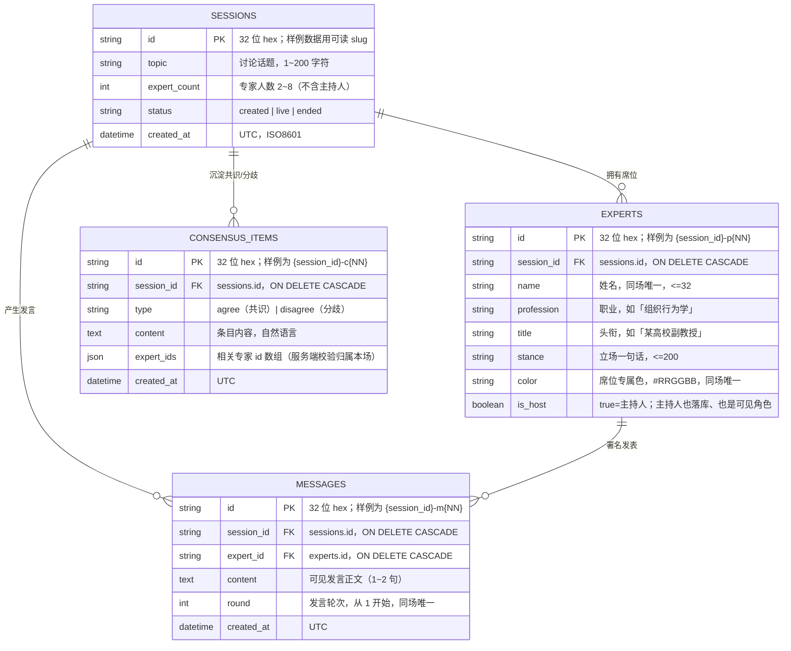
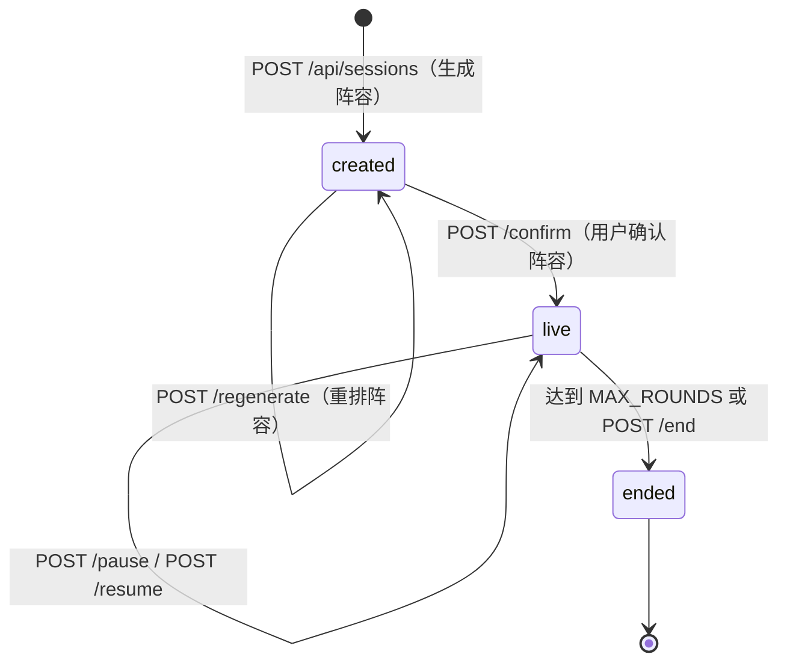
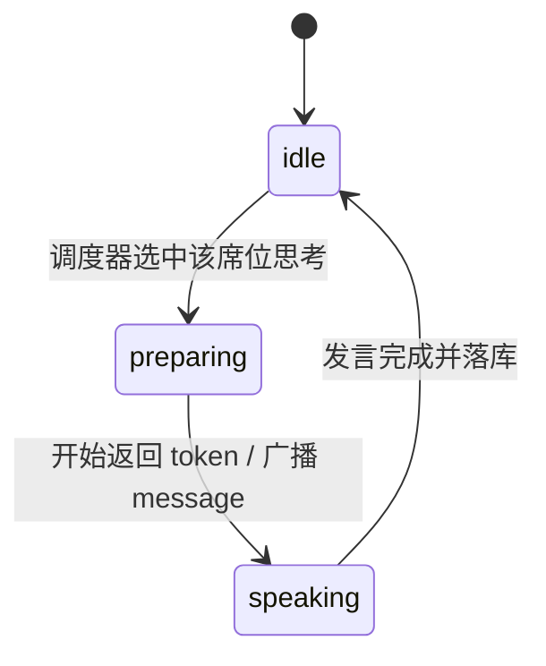

# 数据模型设计（ER）

| 项目 | 内容 |
|---|---|
| 版本 | v1.0（对应 SDD 阶段） |
| 数据库 | SQLite（`data/app.db`，可用 `DATABASE_URL` 覆盖） |
| ORM | SQLAlchemy 2.x 声明式映射（`backend/models.py`） |
| 建表脚本 | `backend/seeds.py`（`python -m backend.seeds`，`--reset` 可重建；`scripts/init_db.py` 为兼容入口） |
| 关联契约 | [`API.md`](./API.md)、[`PRD.md`](./PRD.md) |

---

## 1. 实体关系图

---

## 2. 表结构与约束明细

### 2.1 `sessions`（讨论）

| 列 | 类型 | 空 | 默认 | 说明 |
|---|---|---|---|---|
| `id` | VARCHAR(32) | 否 | uuid hex | 主键 |
| `topic` | VARCHAR(200) | 否 | — | 讨论话题 |
| `expert_count` | INTEGER | 否 | 4 | 专家人数（不含主持人） |
| `status` | VARCHAR(16) | 否 | `created` | `created`/`live`/`ended` |
| `created_at` | DATETIME | 否 | `utc_now()` | UTC |

**约束**：`ck_sessions_status`（状态枚举）、`ck_sessions_expert_count`（2~8）、`ck_sessions_topic_not_blank`（长度≥1）。
**索引**：`ix_sessions_status`、`ix_sessions_created_at`（列表页按状态 + 时间排序）。

### 2.2 `experts`（席位）

| 列 | 类型 | 空 | 说明 |
|---|---|---|---|
| `id` | VARCHAR(32) | 否 | 主键 |
| `session_id` | VARCHAR(32) | 否 | 外键 → `sessions.id`，级联删除 |
| `name` / `profession` / `title` / `stance` | VARCHAR | 否 | 展示字段 |
| `color` | VARCHAR(7) | 否 | `#RRGGBB` |
| `is_host` | BOOLEAN | 否 | 主持人标记 |

**约束**：`ck_experts_color_hex`（`length=7 且首字符为 #`，SQLite 无 REGEXP 故用 substr 实现）、
`uq_experts_session_color`（同场颜色唯一 → PRD AC-2.5）、`uq_experts_session_name`（同场姓名唯一）。
**索引**：`ix_experts_session`。

> **为什么主持人也落库**：Transcript 要求「发言人姓名 + 职业/Title + 一致颜色」，主持人同样需要颜色与身份；
> 用 `is_host` 区分职责，避免为主持人单开一张表造成展示层分叉。

### 2.3 `messages`（可见发言）

| 列 | 类型 | 空 | 说明 |
|---|---|---|---|
| `id` | VARCHAR(32) | 否 | 主键 |
| `session_id` | VARCHAR(32) | 否 | 外键，级联删除 |
| `expert_id` | VARCHAR(32) | 否 | 外键 → `experts.id`，级联删除 |
| `content` | TEXT | 否 | 正文，长度≥1 |
| `round` | INTEGER | 否 | 轮次，≥1 |
| `created_at` | DATETIME | 否 | UTC |

**约束**：`uq_messages_session_round`（同场轮次唯一 → 天然幂等键，同一轮重复写入直接冲突而不是产生重复气泡）、
`ck_messages_round_positive`、`ck_messages_content_not_blank`。
**索引**：`ix_messages_session_round`、`ix_messages_expert`。

> **只存可见发言**：举手、抢答、调度决策、专家状态等**内部事件不落库**（PRD R6）。
> 状态与阶段走 SSE 事件，不进入 Transcript，也不进入本表。

### 2.4 `consensus_items`（共识/分歧）

| 列 | 类型 | 空 | 说明 |
|---|---|---|---|
| `id` | VARCHAR(32) | 否 | 主键 |
| `session_id` | VARCHAR(32) | 否 | 外键，级联删除 |
| `type` | VARCHAR(16) | 否 | `agree` / `disagree` |
| `content` | TEXT | 否 | 自然语言条目 |
| `expert_ids` | JSON | 否 | 相关专家 id 数组，默认 `[]` |
| `created_at` | DATETIME | 否 | UTC |

**约束**：`ck_consensus_type`、`ck_consensus_content_not_blank`。
**索引**：`ix_consensus_session_type`（按场次 + 类型取共识/分歧两栏）。

## 3. 讨论状态机

- `created`：阵容已生成、等待用户确认（等价于 PRD 中的 `ready`）。
- `live`：演播中，SSE 持续推送 `message` / `status` / `consensus` / `phase`。
- `ended`：只读回放；`done` 事件携带 `summary`，此后不再产生任何写事件。

> PRD 中的 `casting`（正在生成阵容）属于**请求内的瞬时态**，不落库；生成失败直接以 4xx/5xx 返回，
> 讨论不会停留在半成品状态。
>
> 图中 `/regenerate`、`/confirm`、`/pause`、`/resume`、`/end` 为**规划中的端点（未实现）**：
> 当前版本由前端「确认阵容」门 + 连接 SSE 触发 `created → live`，暂停只冻结前端打字机，
> 讨论会自行走完并发 `done`。

### 3.1 席位状态（三维之一，仅用于实时状态事件）

三态之外**不存在** `thinking`、`waiting`、`interrupted` 等状态，避免前端出现信息量过大的伪状态（PRD R4）。

---

## 4. 多讨论隔离规则（PRD R9）

| 层级 | 规则 |
|---|---|
| 表结构 | 三张子表全部携带 `session_id` 外键，不设「全局共享」表 |
| 数据访问 | 任何查询以 `WHERE session_id = :session_id` 起手，禁止无过滤的 `select(Message)` |
| 外键一致性 | 写入 `messages` 前校验 `expert.session_id == message.session_id`；`consensus_items.expert_ids` 必须属于本场 |
| 实时通道 | 事件信封必带 `session_id`；广播按 `session_id` 分组，禁止向所有连接群发 |
| 级联清理 | 删除讨论时 `ON DELETE CASCADE` 一并清除席位、发言、共识，避免孤儿数据污染其它场次 |

机器可验证的等价断言（后续 `tests/test_isolation.py`）：
构造 A/B 两场讨论 → 各自写入发言与共识 → 断言 A 的接口结果中不含任何 B 的 `id`。

---

## 5. 字段约定

| 主题 | 约定 |
|---|---|
| 时间 | 全部 UTC naive datetime，API 输出 ISO8601（如 `2026-11-19T05:01:33`），前端按本地时区展示 |
| 颜色 | `#RRGGBB`，后端从 `PANEL_COLOR_PALETTE`（9 色）分配并落库，前端只读 |
| JSON 列 | `consensus_items.expert_ids` 使用 SQLAlchemy `JSON`（SQLite 下存 TEXT，读写自动序列化） |
| 枚举 | 落库存字符串（便于直接查库核对），Python 侧用 `SessionStatus` / `ConsensusType` 枚举 |
| 主键 | 生产路径为 32 位 hex（uuid4）；样例数据用可读 slug，便于 E2E 直接命中固定场次 |
| 排序 | 阵容顺序 = `(is_host DESC, id ASC)`；样例席位 id 形如 `{session_id}-p00/01/…` 保证稳定 |

---

## 6. 与 PRD 的差异与待确认扩展

SDD 阶段按本轮确认的「四表最小字段集」落地。以下字段在 PRD 验收标准中被提及，
但**当前模型未包含**，按要求先记录、待确认后再随迁移补入（不擅自扩大模型）：

| 缺口 | PRD 依据 | 影响 | 建议方案 |
|---|---|---|---|
| `sessions.updated_at` | AC-1.3「最近更新时间」排序 | 列表只能按 `created_at` 排序 | 增加 `updated_at` + `onupdate=utc_now` |
| `experts.stance_axis` | AC-2.6「支持/反对各≥1」需机器可校验 | 目前只能靠 Prompt 约束 + 语义判断 | 增加枚举列（`support/oppose/conditional/neutral`） |
| `messages.turn_type` | AC-3.7 主持人开场/追问/串联可审计；AC-7.5 收尾发言 | 目前只能靠「是否主持人 + 内容」弱推断 | 增加 `turn_type`（opening/followup/bridge/closing/debate） |
| `summaries` 表 | AC-7.6 总结幂等与持久化 | `SummaryOut` 目前无持久化落点 | 新增第 5 张表（推荐），或扩展 `consensus_items`（不推荐） |

> 处理原则：**先保证题目要求的四表结构稳定可用**；扩展项在进入「总结 / 阵容校验」实现前一次性决策，
> 避免反复改表。若你确认，可在下一轮直接追加迁移。

---

## 7. 样例数据覆盖（`backend/seeds.py`）

| 场次 id | 话题 | 状态 | 专家数 | 发言 | 共识/分歧 |
|---|---|---|---|---|---|
| `smp-remote-innovation` | 远程办公是否降低了团队的创新力？ | created | 4 | 0 | 0 |
| `smp-ai-copyright` | AI 生成内容是否应享有著作权保护？ | created | 5 | 0 | 0 |
| `smp-four-day-week` | 公司是否应全面推行四天工作制？ | live | 6 | 4 | 0 |
| `smp-short-video-attention` | 短视频是否高估了对青少年注意力的伤害？ | live | 4 | 4 | 0 |
| `smp-open-model` | 开源大模型会终结闭源商业模型吗？ | ended | 6 | 12 | 5 |
| `smp-hukou-policy` | 一线城市是否应继续放宽落户门槛？ | created | 3 | 0 | 0 |

合计 **6 场讨论 / 34 个席位 / 20 条发言 / 5 条共识或分歧**，满足「≥5 条高质量样例数据」；
其中 `smp-open-model` 带完整发言与共识，可直接验证只读回放与总结展示，无需先跑满一场讨论。

